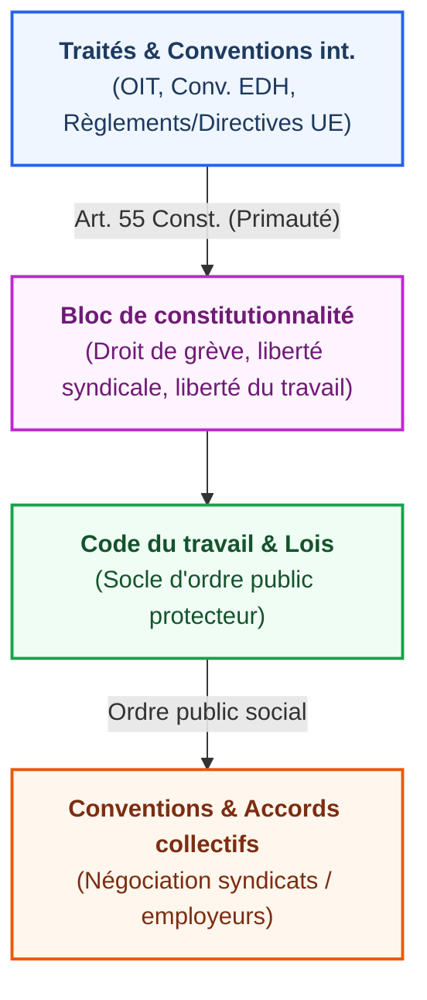
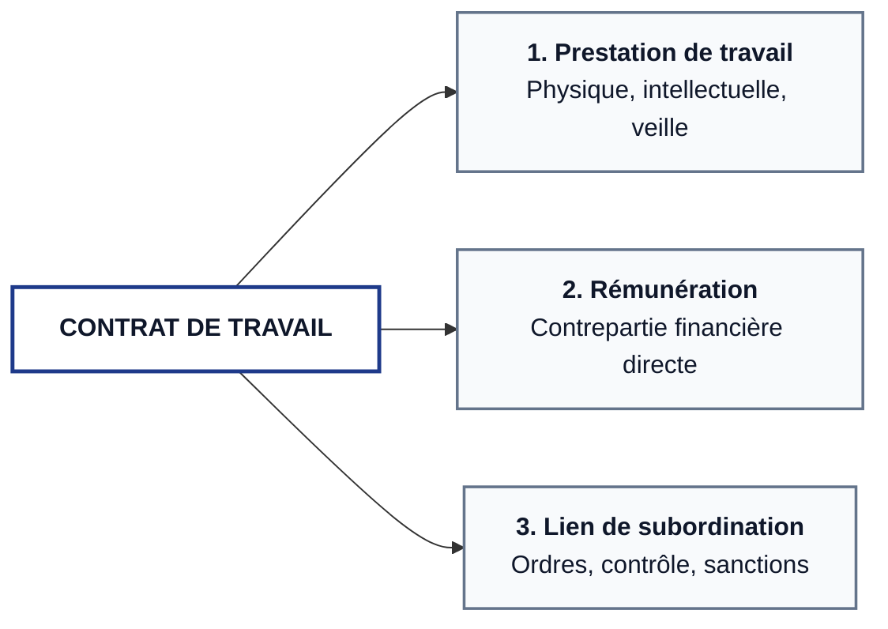

---
{"dg-publish":true,"permalink":"/introduction-au-droit-du-travail/","tags":["travail","CM","droit","AES/S3"],"ctime":"2026-09-10T13:41:46.942+02:00","mtime":"2026-11-19T20:11:21.802+01:00","dg-note-properties":{"tags":["travail","CM","droit","AES/S3"],"class":"[[References/Travail]]","sector":"[[References/AES]]","semester":"[[References/S3]]","form":"[[References/CM]]","part":"[[References/1]]","date created":"2026-09-10, 13 41","date modified":"2026-11-19, 19 55"}}
---

# Introduction et Partie 1, Chapitre 1 : La notion juridique de contrat de travail

> [!note] Articulation du cours & TD associés
> - **Plan maître :** [[Droit du travail - Méthodo\|Droit du travail - Méthodo]]
> - **Annexe textes & arrêts :** [[Textes légaux et réglementaires\|Textes légaux et réglementaires]]
> - **TD associés :** [[Exos TD 1 - Le contrat de travail\|TD 1 — Le contrat de travail]] ([[Plan TD 1 - Le contrat de travail\|Plan TD 1]]) et [[Exos TD 6 - Travailleurs des plateformes et lien de subordination\|TD 6 — Travailleurs des plateformes]]
> - **Chapitre suivant :** [[Partie 1 - Chapitre 2 - Les contrats spéciaux\|Partie 1 - Chapitre 2 - Les contrats spéciaux]]

---

# Introduction au droit du travail

## I. Historique du droit du travail

> [!abstract] Idée directrice
> Le droit du travail est une discipline **récente**, construite pour rééquilibrer un rapport contractuel asymétrique né de la révolution industrielle.

### 1. Le frein de la Révolution française
Contrairement à l'intuition commune, la Révolution de 1789 a bloqué la création d'un droit protecteur :
* **Dogme de la liberté contractuelle** : liberté absolue de négocier de gré à gré, en ignorant le déséquilibre économique entre employeur et ouvrier.
* **Égalité formelle stricte** : traiter le salarié différemment romprait le principe républicain d'égalité entre citoyens.
* **Proscription des corps intermédiaires** :
  * [[Textes légaux et réglementaires#Loi Le Chapelier (1791)\|Loi Le Chapelier (1791)]] : interdiction stricte de toutes les corporations et coalitions ouvrières (syndicats criminalisés).

### 2. L'essor industriel (XIXᵉ – XXᵉ siècles)
L'exploitation de masse et les luttes ouvrières obligent l'État à intervenir :

| Période | Événement clé | Impact juridique |
| :--- | :--- | :--- |
| **Fin XIXᵉ s.** | Premières lois ouvrières | Régulation du travail des enfants et des femmes, durée journalière |
| **1884** | **[[Textes légaux et réglementaires#Loi Waldeck-Rousseau (1884)\|Loi Waldeck-Rousseau]]** | Légalisation des syndicats professionnels |
| **1936** | **Front populaire** | Congés payés, 40 heures, délégués du personnel, conventions collectives |
| **1973 & 2008** | Recodifications | Modernisation et restructuration du [[Code du travail\|Code du travail]] |

---

## II. Les sources du droit du travail

### 1. Hiérarchie des sources

### 2. Rôle des juridictions et traités supranationaux
* **Droit de l'Union européenne** : libre circulation des travailleurs, régulation du détachement, encadrement de la sécurité et de la santé.
* **Organisation internationale du travail (OIT)** : conventions ratifiées créant un standard minimal mondial ([[Art. 55 Const.\|Art. 55 Const.]]).
  > [!example] Arrêt de principe
  > **[[Textes légaux et réglementaires#Cass. soc., 1er juillet 2008 (CNE)\|Cass. soc., 1er juillet 2008]]** : le Contrat nouvelle embauche (CNE) français est invalidé car contraire à la [[Convention n° 158 de l'OIT\|Convention n° 158 de l'OIT]] sur la justification du licenciement.
* **Cour européenne des droits de l'homme (Conv. EDH)** : application de l'[[Art. 8 Conv. EDH\|article 8 de la Conv. EDH]] (protection de la vie privée et secret des correspondances numériques sur l'ordinateur de travail).

---

# Première partie : Présentation générale du contrat de travail

## Chapitre 1 : La notion juridique de contrat de travail

### Section 1 : Définition, principe de réalité et critères constitutifs

#### A. Définition et principe de réalité

> [!quote] Définition jurisprudentielle de référence
> **[[Cass. civ., 22 juillet 1954\|Cass. civ., 22 juillet 1954]]** *(Bull. civ. IV, n° 576)*  
> « Le contrat de travail est une convention par laquelle une personne s'engage à travailler pour le compte d'une autre et sous sa subordination moyennant une rémunération. »

> [!warning] Principe de réalité ([[Arrêt Labbane, Cass. soc., 19 décembre 2000\|Arrêt Labbane, Cass. soc., 19 décembre 2000]])
> La qualification juridique dépend exclusivement des **conditions de fait** de l'activité, et non de l'intitulé inscrit sur le contrat par les parties (jurisprudence constante applicable aux travailleurs des plateformes comme Uber ou Deliveroo).

#### B. Les trois critères constitutifs

##### 1. La prestation de travail
* **Caractère personnel et physique** : seule une **personne physique** peut être salariée (la sous-traitance par le salarié est impossible).
* **Effectivité** : la prestation doit être réelle (nullité des emplois fictifs).
* **Diversité admise** : la tâche peut être active ou passive ([[Textes légaux et réglementaires#Cass. soc., 18 juillet 2001 (Veille de dépôt pétrolier)\|Cass. soc., 18 juillet 2001]] : simple veille d'un dépôt pétrolier sans effort continu).
* **Affaire de *L'Île de la tentation*** ([[Textes légaux et réglementaires#Cass. soc., 3 juin 2009 (Île de la tentation)\|Cass. soc., 3 juin 2009]]) : requalification en contrat de travail retenue car la prestation consistait à participer à des activités imposées et exprimer des réactions guidées en vase clos pour produire un bien ayant une valeur économique.

> [!tip] Cas particulier : Le stage
> Le stage a une finalité exclusivement formative encadrée par une convention tripartite école/entreprise/étudiant ([[Textes légaux et réglementaires#Cass. soc., 14 novembre 2000 (Stage)\|Cass. soc., 14 novembre 2000]]).  
> **Sanction :** s'il compense un accroissement d'activité ou occupe un emploi permanent, il est requalifié judiciairement en **[[CDI\|CDI]]** ([[Textes légaux et réglementaires#Cass. soc., 18 juillet 2001 (Requalification de stage)\|Cass. soc., 18 juillet 2001]]).

##### 2. La rémunération
* Elle est indispensable à la caractérisation d'un contrat de travail : si la rémunération est exclue d'un commun accord, la qualification de contrat de travail est par définition exclue (ex. bénévolat).
* La qualification donnée à cette rémunération est indifférente ([[Textes légaux et réglementaires#Cass. soc., 11 novembre 1991 (Qualification de la rémunération)\|Cass. soc., 11 novembre 1991]]). Inversement, un contrat qui emploie le terme « salaire » n'impose pas la qualification de contrat de travail sans lien de subordination ([[Textes légaux et réglementaires#Cass. soc., 5 février 1992 (Mention salaire neutre)\|Cass. soc., 5 février 1992]]).
* Le mode de calcul est neutre (à l'heure, à la tâche, fixe ou variable / commission, en argent ou en nature tel qu'un logement). Dès lors que le contrat de travail est reconnu, le salarié a droit au salaire minimum (SMIC) ou conventionnel.

##### 3. Le lien de subordination

> [!abstract] Critère déterminant du contrat de travail
> Le contrat de travail se définit par le **lien de subordination juridique** : le salarié accepte par contrat de se soumettre au pouvoir de direction de son employeur.
> - Il **ne se confond pas avec la dépendance économique** : un artisan dépendant d'un unique client n'est pas salarié en l'absence de subordination juridique ([[Arrêt Bardou, Cass. civ., 6 juillet 1931\|Arrêt Bardou, Cass. civ., 6 juillet 1931]]).
> - Selon l'[[Arrêt Société Générale, Cass. soc., 13 novembre 1996\|Arrêt Société Générale, Cass. soc., 13 novembre 1996]], le lien de subordination implique que l'employeur cumule trois prérogatives :
>   1. **Le pouvoir de donner des ordres et directives** (pouvoir de direction).
>   2. **Le pouvoir d'en contrôler l'exécution** (pouvoir de contrôle).
>   3. **Le pouvoir de sanctionner les manquements** (pouvoir de sanction).

* **a. Le pouvoir de direction** : pouvoir d'organiser l'entreprise et le travail des salariés (directement ou par délégation à un préposé). L'absence de consignes et d'instructions interdit la qualification de contrat de travail ([[Textes légaux et réglementaires#Cass. soc., 15 février 2006 (Absence d'instructions)\|Cass. soc., 15 février 2006]]) ; *a contrario*, de simples consignes dans une prestation de service ne suffisent pas à elles seules.
* **b. Le pouvoir de contrôle** : faculté de vérifier le respect des directives (la simple vérification *a posteriori* d'une prestation livrée ne suffit pas à caractériser la subordination).
* **c. Le pouvoir de sanction** : prérogative unilatérale de l'employeur (pouvoir disciplinaire) qui n'a pas besoin d'avoir été exercée concrètement pour être caractérisée.
* **d. Illustrations jurisprudentielles** :
  * **[[Cass. soc., 24 avril 2013\|Cass. soc., 24 avril 2013]]** : pouvoirs de direction occultés dans le contrat et sanctions pécuniaires en cas d'abandon.
  * **[[Cass. soc., 28 novembre 2018\|Cass. soc., 28 novembre 2018]] (*Take Eat Easy*)** : requalification d'un coursier en salarié en raison du suivi GPS en temps réel (contrôle) et du système de pénalités/désactivation (sanction).
  * **[[Cass. soc., 4 mars 2020\|Cass. soc., 4 mars 2020]] (*Uber*)** : requalification d'un chauffeur Uber en salarié (service organisé, tarification et itinéraires imposés, déconnexion/sanction en cas de refus de courses).
  * **[[Cass. soc., 9 juillet 2025\|Cass. soc., 9 juillet 2025]] (*Uber*)** : après révision des conditions contractuelles et du fonctionnement de l'application, la réalité de la subordination juridique n'est pas établie *in concreto* ; en l'absence de directives impératives ou de sanctions directes prouvées, la présomption de non-salariat de l'[[Art. L. 8221-6 C. trav.\|Art. L. 8221-6 C. trav.]] est maintenue.

---

### Section 2 : La preuve du contrat de travail et les présomptions légales

#### A. Les principes généraux

##### 1. Charge et liberté de la preuve
* **Charge de la preuve (article 1353 du Code civil)** : celui qui invoque l'existence d'un contrat de travail (le travailleur demandant la requalification) doit prouver les trois critères constitutifs ; inversement, l'employeur qui entend écarter un contrat apparent doit prouver son caractère fictif.
* **Liberté de la preuve** : la preuve du contrat de travail est libre et peut être rapportée **par tout moyen** ([[Textes légaux et réglementaires#Cass. soc., 28 avril 1955 (Liberté de la preuve)\|Cass. soc., 28 avril 1955]]).
* **Contrat apparent** : la délivrance d'un contrat écrit apparent ou de bulletins de paie crée une **présomption simple** d'existence du contrat de travail ([[Textes légaux et réglementaires#Cass. soc., 26 juin 1969 (Apparence de contrat)\|Cass. soc., 26 juin 1969]]).
* **Forme** : le [[CDI\|CDI]] à temps plein peut être verbal ou tacite (hors formalisme de notice écrite européenne), alors que certains contrats spéciaux imposent un écrit obligatoire ([[CDD\|CDD]], temps partiel).

##### 2. La méthode du faisceau d'indices
Les juges apprécient le lien de subordination via un **faisceau d'indices** (éléments convergents pris ensemble) :
* Travail au sein d'un **service organisé** dont l'employeur détermine unilatéralement les conditions ([[Arrêt Société Générale, Cass. soc., 13 novembre 1996\|Arrêt Société Générale, Cass. soc., 13 novembre 1996]] — ex. sportif professionnel ou médecin en clinique disposant d'autonomie technique mais soumis au cadre collectif).
* Contraintes horaires, détermination du lieu de travail, fourniture du matériel nécessaire à la prestation.

#### B. Les présomptions légales

##### 1. Les présomptions d'existence du contrat de travail
* **Présomption irréfragable — Les VRP (voyageurs, représentants et placiers)** :
  * Statut défini à l'[[Textes légaux et réglementaires#Article L. 7311-3 du Code du travail\|article L. 7311-3 C. trav.]] et présomption posée à l'[[Textes légaux et réglementaires#Article L. 7313-1 du Code du travail\|article L. 7313-1 C. trav.]].
  * En raison de son indépendance d'organisation, le VRP n'est pas soumis au salaire minimum horaire (*Cass. soc., 11 mars 1998*), sauf s'il est soumis à des contraintes horaires strictes ([[Textes légaux et réglementaires#Cass. soc., 30 juin 1999 (VRP et contraintes horaires)\|Cass. soc., 30 juin 1999]]).
* **Présomptions simples (renversables par l'employeur en prouvant l'absence de subordination)** :
  * **Journalistes professionnels** ([[Textes légaux et réglementaires#Article L. 7112-1 du Code du travail\|article L. 7112-1 C. trav.]]).
  * **Artistes du spectacle** ([[Textes légaux et réglementaires#Articles L. 7121-1 à L. 7121-4 du Code du travail (Artistes du spectacle)\|articles L. 7121-1 à L. 7121-4 C. trav.]]).
  * **Mannequins** ([[Textes légaux et réglementaires#Articles L. 7123-3 et L. 7123-4 du Code du travail (Mannequins)\|articles L. 7123-3 et L. 7123-4 C. trav.]]).

##### 2. La présomption d'absence de contrat de travail (non-salariat)
* Aux termes de l'[[Art. L. 8221-6 C. trav.\|Art. L. 8221-6 C. trav.]], les personnes immatriculées au titre d'une activité indépendante (RCS, répertoire des métiers, auto-entrepreneurs, dirigeants sociaux) sont **présumées ne pas être liées** au donneur d'ordre par un contrat de travail.
* **Présomption simple** : le travailleur peut renverser cette présomption en établissant qu'il exécute sa prestation dans un lien de subordination juridique permanente à l'égard du donneur d'ordre.

---

## Liens associés
- [[Droit du travail - Méthodo\|Droit du travail - Méthodo]]
- [[Textes légaux et réglementaires\|Textes légaux et réglementaires]]
- [[Partie 1 - Chapitre 2 - Les contrats spéciaux\|Partie 1 - Chapitre 2 - Les contrats spéciaux]]
- [[Exos TD 1 - Le contrat de travail\|Exos TD 1 - Le contrat de travail]]
- [[Exos TD 6 - Travailleurs des plateformes et lien de subordination\|Exos TD 6 - Travailleurs des plateformes et lien de subordination]]
- [[Art. 55 Const.\|Art. 55 Const.]]
- [[Art. 8 Conv. EDH\|Art. 8 Conv. EDH]]
- [[Convention n° 158 de l'OIT\|Convention n° 158 de l'OIT]]
- [[Art. L. 8221-6 C. trav.\|Art. L. 8221-6 C. trav.]]
- [[Cass. civ., 22 juillet 1954\|Cass. civ., 22 juillet 1954]]
- [[Arrêt Bardou, Cass. civ., 6 juillet 1931\|Arrêt Bardou, Cass. civ., 6 juillet 1931]]
- [[Arrêt Société Générale, Cass. soc., 13 novembre 1996\|Arrêt Société Générale, Cass. soc., 13 novembre 1996]]
- [[Arrêt Labbane, Cass. soc., 19 décembre 2000\|Arrêt Labbane, Cass. soc., 19 décembre 2000]]
- [[Cass. soc., 24 avril 2013\|Cass. soc., 24 avril 2013]]
- [[Cass. soc., 28 novembre 2018\|Cass. soc., 28 novembre 2018]]
- [[Cass. soc., 4 mars 2020\|Cass. soc., 4 mars 2020]]
- [[Cass. soc., 9 juillet 2025\|Cass. soc., 9 juillet 2025]]
- [[Code du travail\|Code du travail]]
- [[CDI\|CDI]]
- [[CDD\|CDD]]
