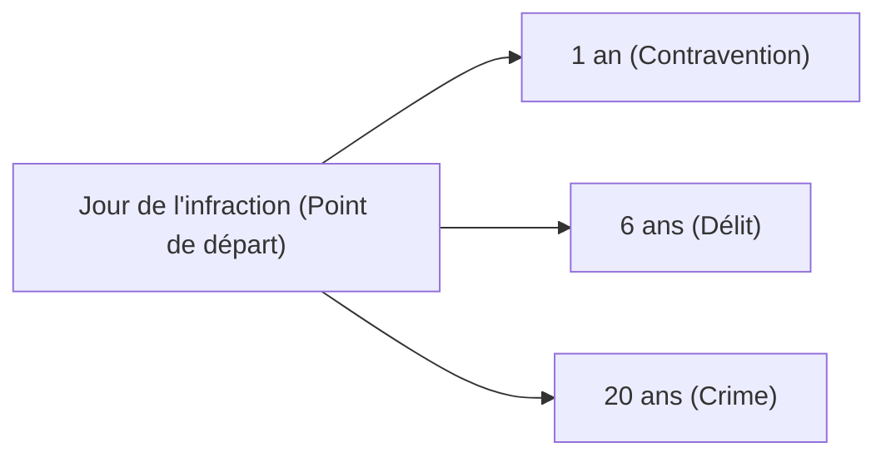
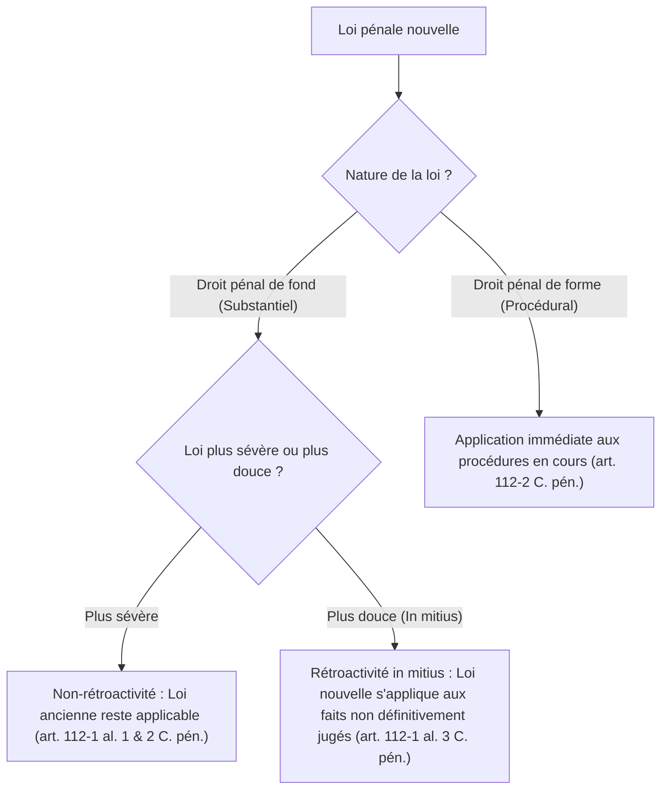

---
{"dg-publish":true,"permalink":"/partie-1-la-norme-penale/","tags":["AES/S3/pénal","CM","droit","AES/S3"],"dg-note-properties":{"date created":"2026-09-16, 11 50","date modified":"2026-11-18, 19 00","sector":"[[References/AES]]","semester":"[[References/S3]]","class":"[[References/Pénal]]","form":"[[References/CM]]","part":"[[References/1]]","tags":["AES/S3/pénal","CM","droit","AES/S3"]}}
---

# Partie 1 - La norme pénale

# Titre 1 - Le fonctionnement de la norme pénale

- **Principes généraux** : **[[Art. 111-1 C. pén.\|Art. 111-1 C. pén.]]**, le premier article, affirme la classification tripartite des infractions, à savoir :
  - Les crimes
  - Les délits
  - Les contraventions

> [!cite] **[[Art. 111-1 C. pén.\|Art. 111-1 C. pén.]] :** *Les infractions pénales sont classées, suivant leur gravité, en crimes, délits et contraventions.*

## Chapitre 1 - La définition légale de l'infraction

- **Classification des infractions** :
  - selon leur gravité
  - selon leur nature

  Le critère de la peine principale est alors retenu pour caractériser une infraction en rapport avec la qualification légale.  
  *La peine principale étant la peine prévue par le législateur pour l'infraction considérée, encourue, déterminée dans un plafond maximal légal.*

- Tripartition légale des infractions.  
  La doctrine propose également une classification basée sur la nature légale des infractions.

### 1. Contraventions
- Une **contravention** est une infraction punie d'une **peine contraventionnelle**.
- Selon **l'échelle des peines**, elle consiste exclusivement en une peine d'amende qui **n'excède pas 1 500 €**.

> [!info] Il n'y a pas de peine privative de liberté en matière contraventionnelle.

- Le législateur distingue 5 classes de contraventions :
  - 1re classe : 38 €
  - 2e classe : 150 €
  - 3e classe : 450 €
  - 4e classe : 750 €
  - 5e classe : 1 500 €

### 2. Délits
- Un **délit** est une infraction punie d'une **peine délictuelle**, c'est-à-dire une peine d'amende ***et/ou*** une peine privative de liberté.

> [!info] En matière délictuelle, on utilise le terme emprisonnement.

- En matière délictuelle, **l'amende n'a pas de plafond général**. Le législateur pose un plancher de 3 750 €.
- En termes de privation de liberté, le législateur dispose d'une **échelle légale** :

### 3. Crimes
- Un **crime** est une infraction punie d'une **peine criminelle**. La peine criminelle est exclusivement une **peine privative de liberté**.

> [!info] On ne parle plus d'emprisonnement mais de **réclusion criminelle**.

- Elle comporte là aussi une échelle légale, appelée **réclusion à temps** :
  - 15 ans pour le 1er degré
  - 20 ans pour le 2e degré
  - 30 ans pour le 3e degré
  - La réclusion criminelle à perpétuité

- On ne se limite jamais à l'infraction de base : des **circonstances aggravantes** peuvent modifier la qualification et aggraver la répression.

> [!example] Ex. Un vol, délit de base, commis avec une arme, devient un crime du premier degré (vol à main armé). L'emprisonnement devient réclusion criminelle, et l'on peut trouver une amende en matière criminelle par le prisme des circonstances aggravantes (ex. 150 000 € d'amende).

### 4. Les intérêts à la classification
- Cette classification emporte des conséquences tant du point de vue **des sources et des organes** compétents pour créer des infractions, que **du point de vue procédural**, car un certain nombre de règles du procès pénal dépendent de cette classification.

---

Du point de vue des sources, [[Art. 111-2 C. pén.\|Art. 111-2 C. pén.]] dispose :
> [!cite] *La loi détermine les crimes et délits et fixe les peines applicables à leurs auteurs. Le règlement détermine les contraventions et fixe, dans les limites et selon les distinctions établies par la loi, les peines applicables aux contrevenants.*

- **Crimes et délits** = **Parlement seul** (loi). Seul habilité à prévoir des peines d'emprisonnement.
- **Contraventions** = **Gouvernement** (décret en Conseil d'État). Amendes strictement encadrées par la loi, jamais de prison.
- **Juge pénal** : a le pouvoir d'écarter un règlement illégal ([[Art. 111-5 C. pén.\|Art. 111-5 C. pén.]]).

---

Outre les sources légales, au niveau du droit pénal de fond, toute une **série de règles** dépend de la **classification tripartite des infractions** :

- Du point de vue de **l'élément moral** :
  - la nature de la faute peut être **volontaire ou involontaire** en matière de contravention et de délit,
  - mais **exclusivement volontaire** en matière de crime.  
    *Ex. Il n'existe pas d'homicide non intentionnel criminel.*

- Au niveau de la tentative, il y a deux façons d'être auteur : d'une **infraction consommée** et d'une **tentative** :
  - En matière de crime : la **pensée** n'est pas punissable, la **préméditation** n'est pas punissable en soi, la **tentative** l'est toujours, et l'**infraction consommée** l'est également.
  - En matière de délit : la tentative est punie exclusivement dans les cas **expressément prévus par le législateur**.
  - En matière de contravention : la tentative **n'est jamais punissable**.

---

- La classification a également son importance dans **l'application de la loi dans le temps**.

---

- **Le droit pénal de forme** est aussi tributaire de la classification tripartite des infractions :
  - Le crime relève de la **Cour d'assises** (ou de la cour criminelle départementale).
  - Les délits relèvent du **tribunal correctionnel**.
  - Les contraventions relèvent du **tribunal de police**.

- Dans le droit pénal de forme, la classification tripartite influence également le **déroulement de la procédure** :
  - L'instruction en matière **criminelle** est **obligatoire**.
  - Elle est **facultative** en matière de **délit** et de **contravention**.

---

- **L'action publique**, action par laquelle le ministère public, représentant de l'État, exerce les poursuites et déclenche le procès pénal, est soumise à des **délais de prescription** qui varient selon la classification tripartite. À l'expiration de ce délai à compter du jour de la commission de l'infraction, l'action publique est **prescrite**.

  Les délais de droit commun sont ([[Loi du 27 février 2017\|Loi du 27 février 2017]]) :
  - **1 an** pour les contraventions
  - **6 ans** pour les délits
  - **20 ans** pour les crimes

## Chapitre 2 - Le principe de légalité

> [!quote] Beccaria - Traité des délits et des peines, 1764
> "*Nullum crimen, nulla poena sine lege*"

- Ce principe est exprimé à l'article [[Art. 111-3 C. pén.\|Art. 111-3 C. pén.]] :
> [!quote] Article 111-3
> Nul ne peut être puni pour un crime ou pour un délit dont les éléments ne sont pas définis par la loi, ou pour une contravention dont les éléments ne sont pas définis par le règlement.  
> Nul ne peut être puni d'une peine qui n'est pas prévue par la loi, si l'infraction est un crime ou un délit, ou par le règlement, si l'infraction est une contravention.

- Le principe de légalité vise aussi bien **l'incrimination** que la **peine**. Il exige l'existence d'une norme pénale **préexistante** à l'acte incriminé et à sa sanction.
- De ce point de vue, le principe de légalité remplit une fonction **symbolique** et protectrice :
  - tout ce qui n'est pas interdit pénalement est **autorisé** ;
  - il préserve la **sécurité juridique** ;
  - il empêche l'**arbitraire** du juge.

### 1. Signification du principe à l'égard du juge pour les infractions
- Le juge ne peut pas créer **arbitrairement** des infractions. Il a donc **l'obligation** de vérifier l'existence d'un texte répressif pour considérer que les faits dont il est saisi sont **punissables**. Cette obligation renvoie à la **qualification juridique des faits**, opération intellectuelle consistant pour le juge à confronter les **faits** dont il est saisi à la **norme pénale applicable**.

> [!caution] Tous les comportements qui ne font l'objet d'aucun texte pénal échappent à la répression. Il n'appartient pas au juge de pallier l'insuffisance d'un texte.

### 2. Signification du principe à l'égard du juge pour les peines
- Pour chaque infraction, un texte doit prévoir à l'avance une peine déterminée dans son ***quantum*** (les peines encourues) et dans **ses modalités d'application**. Le juge doit prononcer la sanction dans la limite de ce qu'a prévu le législateur, en respectant les **plafonds légaux encourus**.
- **Il n'est pas tenu de prononcer le maximum légalement encouru** : il peut **diminuer** le quantum ou l'**assortir** de modalités prévues par le Code pénal, en fonction des **circonstances** et de la personnalité du délinquant, en vertu du **principe de personnalisation / [[Individualisation judiciaire\|Individualisation judiciaire]]**.

> [!success] Le ***principe d'individualisation des peines*** est un principe à valeur constitutionnelle fondé sur **[[Art. 8 DDHC 1789\|Art. 8 DDHC 1789]]** et consacré par le Conseil constitutionnel le **22 juillet 2005**.

### 3. Conséquences à l'égard du législateur
- Encore faut-il que le texte soit suffisamment **clair** et **précis** dans son incrimination comme dans sa peine.
- **Exigence constitutionnelle de qualité du texte pénal**, issue de la **[[Décision des 19 et 20 janvier 1981 (Sécurité et liberté)\|Décision des 19 et 20 janvier 1981 (Sécurité et liberté)]]** : le Conseil constitutionnel peut **censurer** une disposition qui ne serait pas conforme à cette exigence de clarté et de précision.

> [!example] Ex. **Le harcèlement sexuel**, défini de manière imprécise par le seul mot *harceler*, a été **[[Décision n° 2012-240 QPC du 4 mai 2012\|abrogé le 4 mai 2012]]** pour défaut de clarté et de précision. Par la **[[Loi du 6 août 2012\|Loi du 6 août 2012]]**, le délit a été réintroduit dans le Code pénal avec une définition précise.

- En comparaison, la Cour européenne des droits de l'Homme adopte une conception matérielle de la légalité intégrant la jurisprudence aux côtés de la loi écrite.

> [!example] Ex. **[[Arrêt Cantoni c. France (1996)\|Arrêt Cantoni c. France (1996)]]** considère que ***"la condition de clarté*** est remplie lorsque le justiciable peut savoir à partir du libellé de la disposition pertinente et au besoin à l'aide de son interprétation par les tribunaux quels **actes** et **omissions** engagent sa responsabilité pénale".

### 4. Les forces et les faiblesses du principe de légalité

##### A. Faiblesses (ou imperfections)
1. En référence à **[[Art. 111-2 C. pén.\|Art. 111-2 C. pén.]]**, le principe de légalité devrait relever des parlementaires élus représentant le peuple (légalité **==formelle==**). Mais la source de la norme pénale peut aussi être le **règlement** (l'exécutif) pour les contraventions : la légalité devient surtout ==**textuelle / matérielle**== (ce qui importe est l'existence d'un texte), affaiblissant le monopole du législateur au sens formel.
2. L'usage de termes **==vagues==** dans les **incriminations**, alors que le Conseil constitutionnel exige des éléments **clairs** et **précis**.
3. Le **==renvoi==** à un autre texte (incrimination par renvoi), technique qui utilise une **autre norme** pour définir une infraction et **dilue** la lisibilité et la clarté de la norme.
4. L'==**imprécision**== ou l'ampleur excessive de certaines peines encourues (ex. le *délit d'initié*, dont l'amende peut être indexée sur le profit réalisé).

##### B. Forces
1. De multiples contrôles sont organisés :
   1. Le contrôle exercé par le juge judiciaire. Il n'a pas pour effet d'annuler la norme pénale, mais d'écarter le texte de son application à l'espèce.

   > [!info] Le texte **reste en vigueur**, mais il n'est pas appliqué au cas d'espèce.

###### a. Le contrôle spécifique des normes réglementaires ou **==exception d'illégalité==**
- Une norme administrative fait l'objet d'un **contrôle** par le juge pénal à la demande du justiciable.
- Ce moyen doit être soulevé *in limine litis* (ou tout au long du procès pénal selon l'office du juge). Le juge statue sur la légalité de l'acte administratif et, s'il est illégal, l'écarte pour le cas d'espèce.
- En revanche, pour faire **annuler** un acte administratif *erga omnes*, il faut saisir le juge administratif ([[Conseil d'État\|Conseil d'État]], recours pour excès de pouvoir contre les actes administratifs réglementaires ou individuels).
- Ce dispositif est prévu à l'article [[Art. 111-5 C. pén.\|Art. 111-5 C. pén.]] :
  *Les **juridictions pénales** sont compétentes pour interpréter les actes administratifs, réglementaires ou individuels et pour en apprécier la légalité lorsque, de cet examen, dépend la solution du procès pénal qui leur est soumis.*
- Deux étapes :
  1. Le juge examine sa compétence.
  2. Il apprécie la légalité de l'acte administratif.

> [!tldr] En conclusion
> Le contrôle de légalité ne peut s'opérer que si les éléments constitutifs d'une infraction ou la solution du procès pénal dépendent de l'acte administratif. Il est exclu lorsque la sanction ou la perte de droits est purement automatique et ne dépend pas d'une décision administrative.

***Exemple*** : Le permis à points instauré par la loi du [[Loi du 10 juillet 1989\|10 juillet 1989]] :
1. **[[Crim., 11 juillet 1994\|Crim., 11 juillet 1994]]** : La juridiction pénale se déclare **incompétente** pour apprécier l'exception d'illégalité concernant le retrait de points automatique consécutif à une contravention.
2. **[[Arrêt Roche (1996)\|Arrêt Roche (1996)]]** : Le juge pénal s'est déclaré **compétent** pour contrôler la légalité de l'injonction de restitution du permis de conduire suite à la perte totale des points, dès lors que la solution du procès pénal (conduite malgré invalidation) en dépend. Passant à la 2e étape, la Cour a jugé le système de retrait de points conforme au principe de légalité et à la Convention EDH, chaque perte partielle étant subordonnée à la reconnaissance préalable de culpabilité.

###### b. Le contrôle applicable à toutes les normes pénales : le contrôle de conventionnalité
- Conformément à **[[Art. 55 Const.\|Art. 55 Const.]]**, le juge pénal contrôle la conformité de toute norme interne (loi ou règlement) aux traités internationaux et notamment à la Convention EDH, et peut l'écarter en cas d'inconventionnalité.
- Ce contrôle peut être soulevé par le justiciable ou relevé d'office par le juge.

> [!info] **Illustrations**
> 1. **Les dispositions en matière de garde à vue** : la Chambre criminelle a censuré ces dispositions pour contrariété à la Convention EDH [[le 11 avril 2011\|le 11 avril 2011]] et appliqué immédiatement la norme européenne.
> 2. **La dissimulation du visage dans l'espace public** : invoquée devant le juge pénal au regard de l'[[Art. 9 Conv. EDH\|Art. 9 Conv. EDH]] (liberté religieuse) et des impératifs de sécurité publique (décision du 5 mars 2013).

##### 2. Le contrôle de constitutionnalité (QPC et contrôle *a priori*)
1. **Contrôle *a posteriori* (QPC)** : le Conseil constitutionnel peut censurer et abroger une disposition législative à la demande du justiciable lors d'une procédure pénale.
2. **Contrôle *a priori*** : saisine par les parlementaires ou autorités publiques avant promulgation, conduisant à la censure des textes méconnaissant l'exigence de clarté et de précision.
3. **Contrôle européen** : intervention de la Cour EDH après épuisement des voies de recours internes.

## Chapitre 3 - Le principe de l'interprétation stricte

***Interprétation*** : consiste à **chercher le sens exact** de la norme pénale pour en déterminer le domaine d'application. Par la suite, le juge opère la **qualification pénale**. Autrement dit, ==**l'interprétation est le préalable**== à la qualification pénale des faits.

L'[[Art. 111-4 C. pén.\|Art. 111-4 C. pén.]] fixe la méthode d'interprétation du juge :
> [!cite] **[[Art. 111-4 C. pén.\|Art. 111-4 C. pén.]]**
> *" La loi pénale est d'interprétation stricte. "*

### I. Interpréter strictement le texte ne signifie pas interprétation littérale par le juge

- ==L'interprétation littérale est **possible** mais elle n'est **pas obligatoire**==.
- ==L'interprétation stricte **prohibe** toute forme de raisonnement par ***analogie***== :
  - L'***analogie*** est totalement prohibée en droit pénal (du moins *in malam partem*). Elle consiste à appliquer un texte à des situations non prévues par le législateur mais qui présentent des similitudes avec celles qu'il vise.

> [!question] Ex. Le contentieux relatif à l'enfant à naître
> **Situation 1** : Une femme est victime d'un accident de la route et perd l'enfant qu'elle portait. Peut-on poursuivre le conducteur responsable pour homicide involontaire ?
> **Situation 2** : [[Arrêt Affaire Vaux\|Arrêt Affaire Vaux]] — interversion de dossiers médicaux entre un retrait de stérilet et un suivi de grossesse, entraînant la perte d'un fœtus. Peut-on poursuivre le médecin ?
>
> **Question commune** : *Peut-on condamner l'auteur pour homicide involontaire sur l'enfant à naître ?*
> 1. La Cour examine la définition de l'homicide involontaire : le fait de causer involontairement la mort à **autrui**.
> 2. En vertu de l'interprétation stricte, le juge ne peut étendre par analogie la notion d'" autrui " à l'enfant à naître qui n'est pas encore né vivant et viable.
> 3. En conséquence, les prévenus ont été relaxés du chef d'homicide involontaire.

- ==L'interprétation stricte autorise le raisonnement téléologique== : s'inspirer de l'esprit et du but poursuivi par la loi pour l'appliquer aux faits commis (ex. conduite sans s'assurer de disposer des facultés matérielles pour le faire).
- ==L'interprétation stricte a parfois conduit le juge à raisonner ***contra legem***== (à l'encontre de la lettre du texte) :
  - *Ex. en droit pénal des affaires* : dans l'abus de biens sociaux, la notion d'" usage " implique normalement un acte positif, mais la Chambre criminelle y a parfois assimilé une abstention (non-réclamation d'une dette).
  - *Ex. ==l'affaire du sang contaminé== ([[Crim., 18 juin 1993, Sang contaminé\|Crim., 18 juin 1993, Sang contaminé]])* : la qualification d'empoisonnement (qui suppose un dol spécial strictement intentionnel d'administration de substance mortifère avec intention de tuer) n'a pas été retenue faute de preuve de l'intention homicide, conduisant à retenir des qualifications non intentionnelles ou de tromperie.

---

# Titre 2 - L'application de la norme pénale

> [!abstract] **Principes d'application de la règle pénale**
> - **Durée d'application** : Par principe, la norme pénale est applicable de son entrée en vigueur jusqu'à son **abrogation**.
> - **Entrée en vigueur** : Les lois et actes administratifs entrent en vigueur le **lendemain de leur publication** au Journal Officiel.
> - **Différé d'entrée en vigueur** : Le législateur peut reporter l'entrée en vigueur pour des raisons d'adaptation pédagogique ou d'organisation administrative.
>   - *Exemple* : La [[Loi du 9 mars 2004\|Loi du 9 mars 2004]] a supprimé le principe de spécialité pour la responsabilité pénale des personnes morales, mais son entrée en vigueur a été différée au [[31 décembre 2005\|31 décembre 2005]].

> [!quote] **Portalis** – *"Avertir avant de frapper."*

> [!cite] **[[Art. 8 DDHC 1789\|Art. 8 DDHC 1789]]**
> *"La loi ne doit établir que des peines strictement et évidemment nécessaires, et nul ne peut être puni qu'en vertu d'une loi établie et promulguée antérieurement au délit, et légalement appliquée."*

> [!cite] **[[Art. 7 Conv. EDH\|Art. 7 Conv. EDH]]**
> *"Nul ne peut être condamné pour une action ou une omission qui, au moment où elle a été commise, ne constituait pas une infraction d'après le droit national ou international. De même, il ne peut être infligé aucune peine plus forte que celle qui était applicable au moment où l'infraction a été commise."*

---

## Chapitre 1 - L'application de la loi pénale dans le temps

### 1. Les règles de conflit applicables au droit pénal de fond

- **Condition préalable du conflit de lois** : Un fait commis sous l'empire de la loi ancienne **ne doit pas avoir fait l'objet d'une condamnation définitive** (épuisement des voies de recours ou expiration des délais d'exercice de ces recours). Ce qui est définitivement jugé ne peut plus être remis en cause.

#### A. Le principe de non-rétroactivité des lois pénales de fond plus sévères

- **Ancrage légal** : [[Art. 112-1 al. 1 et 2 C. pén.\|Art. 112-1 al. 1 et 2 C. pén.]]
  - *Alinéa 1* : Sont seuls punissables les faits constitutifs d'une infraction à la date à laquelle ils ont été commis.
  - *Alinéa 2* : Peuvent seules être prononcées les peines légalement applicables à la même date.
- **Critère de comparaison** : Analyse comparative entre la loi ancienne et la loi nouvelle. Si la loi nouvelle aggrave la situation pénale, elle ne s'applique pas aux faits antérieurs.
- **Domaine des dispositions plus sévères** :
  - **Relatif aux incriminations** :
    - Création d'une nouvelle incrimination.
    - Élargissement du champ d'application d'une incrimination existante (ex. suppression de la condition de subordination hiérarchique en matière de harcèlement sexuel).
    - Suppression d'une condition d'irresponsabilité ou élargissement de la responsabilité (ex. suppression du principe de spécialité des personnes morales par la [[Loi du 9 mars 2004\|Loi du 9 mars 2004]]).
  - **Relatif aux pénalités** :
    - Création d'une nouvelle circonstance aggravante.
    - Augmentation du quantum maximal d'une peine.
    - Adjonction d'une peine complémentaire obligatoire ou facultative.
    - Passage d'un délit à un crime (*criminalisation légale*).

#### B. L'exception : La rétroactivité *in mitius* des lois pénales de fond plus favorables

> [!cite] **[[Art. 112-1 al. 3 C. pén.\|Art. 112-1 al. 3 C. pén.]]**
> *"Toutefois, les dispositions nouvelles s'appliquent aux infractions commises avant leur entrée en vigueur et n'ayant pas donné lieu à une condamnation passée en force de chose jugée lorsqu'elles sont moins sévères que les dispositions anciennes."*

- **Justification** : Fonde la réaction pénale sur la nécessité stricte des peines. Si la société estime qu'un comportement est moins grave ou ne doit plus être sanctionné, la répression antérieure n'a plus de légitimité sociale.
- **Domaine des dispositions plus douces (*in mitius*)** :
  - **Relatif aux incriminations** :
    - Suppression d'une incrimination (*dépénalisation*).
    - Restriction des éléments constitutifs de l'infraction (ex. ajout d'une condition supplémentaire pour retenir l'infraction).
    - Création ou élargissement d'un fait justificatif, d'une cause de non-imputabilité ou d'une immunité (ex. élargissement de l'immunité familiale en matière de vol entre époux).
  - **Relatif aux pénalités** :
    - Suppression d'une peine principale ou complémentaire.
    - Suppression d'une circonstance aggravante.
    - Diminution du quantum de la peine encourue.
    - Transformation d'un crime en délit (*correctionnalisation légale*).

| Type de loi nouvelle (Fond) | Qualification juridique | Effet dans le temps |
| :--- | :--- | :--- |
| **Création d'une infraction / Réponse plus sévère** | Loi de fond plus sévère | **Non-rétroactivité** (Appliquée uniquement aux faits futurs) |
| **Dépénalisation / Peine réduite / Immunité** | Loi de fond plus douce (*In mitius*) | **Rétroactivité *in mitius*** (Appliquée aux faits non définitivement jugés) |

#### C. La mise en œuvre des principes : la qualification et le moment de commission de l'infraction

Pour déterminer quelle loi s'applique, le juge doit localiser précisément la date de consommation de l'élément matériel de l'infraction :

1. **Infractions instantanées** :
   - *Définition* : L'élément matériel se réalise en un trait de temps immédiatement (ex. le *vol* par soustraction frauduleuse).
   - *Régime* : La date de l'acte matériel fixe la loi applicable. Si l'acte a lieu avant la loi nouvelle, la loi ancienne régit l'infraction.
2. **Infractions continues** :
   - *Définition* : L'élément matériel se prolonge dans le temps par la réitération d'une volonté coupable (ex. le *recel* par détention d'une chose volée).
   - *Régime* : Si l'activité délictuelle se poursuit après l'entrée en vigueur de la loi nouvelle, la loi nouvelle s'applique immédiatement à l'ensemble du comportement sans poser de difficulté de rétroactivité.
3. **Infractions d'habitude** :
   - *Définition* : L'élément matériel exige la répétition d'au moins deux actes identiques pour être constitué (ex. *exercice illégal de la médecine*, *appels téléphoniques malveillants*).
   - *Régime* : Si le premier acte est commis sous la loi ancienne et le second sous la loi nouvelle, l'infraction n'est consommée qu'au jour du second acte. La loi nouvelle s'applique donc directement.

---

### 2. Le principe de l'application immédiate du droit pénal formel

> [!abstract] **Règle générale de procédure**
> - **Textes d'ancrage** : Articles [[Art. 112-2 C. pén.\|112-2 à 112-4 du Code pénal]].
> - **Principe** : Les lois de procédure (droit pénal de forme) sont d'**application immédiate** aux procédures en cours dès leur entrée en vigueur, tant que la décision sur le fond n'est pas devenue définitive.
> - **Raison d'être** : Les lois de procédure sont présumées assurer une meilleure administration de la justice.

- **Domaine d'application de la loi de forme** :
  1. **Lois de compétence et d'organisation judiciaire** (ex. création ou transfert de compétence vers une nouvelle juridiction).
  2. **Lois régissant les formes du procès et le déroulement de la procédure** (ex. règles relatives aux voies de recours ou aux actes d'enquête).
  3. **Lois relatives à la prescription de l'action publique** :
     - S'appliquent immédiatement aux prescriptions en cours non encore acquises.
     - *Exemple* : La [[Loi du 27 février 2017\|Loi du 27 février 2017]] a allongé les délais de prescription de droit commun de 3 à 6 ans pour les délits, et de 10 à 20 ans pour les crimes.
  4. **Lois relatives à l'exécution et au régime d'application des peines** (ex. règles sur la libération conditionnelle ou l'aménagement de peine).

> [!important] **Réserve des actes accomplis**
> L'application immédiate n'invalide pas les actes régulièrement accomplis sous l'empire de la loi ancienne. Elle saisit la procédure dans l'état où elle se trouve.

---

## Chapitre 2 - L'application de la loi pénale dans l'espace

> [!abstract] **Principe de coïncidence des compétences**
> En droit pénal, la compétence de la loi pénale d'un État et la compétence de ses juridictions répressives sont indissociables : dès lors que la **loi pénale française** est applicable, le **juge pénal français** est exclusivement compétent pour l'appliquer.

### 1. Les 4 systèmes théoriques d'application de la loi dans l'espace

| Système théorique | Critère de rattachement | Avantages / Inconvénients |
| :--- | :--- | :--- |
| **1. Territorialité** | Lieu de commission de l'infraction sur le territoire de l'État. | Respect parfait de la souveraineté territoriale, mais inopérant pour les faits commis à l'étranger. |
| **2. Personnalité (Compétence personnelle)** | Nationalité de l'auteur (**personnalité active**) ou de la victime (**personnalité passive**). | Poursuit les nationaux à l'étranger ou protège les victimes nationales, mais crée des conflits de souveraineté. |
| **3. Compétence réelle** | Nature de l'infraction (Atteinte aux intérêts supérieurs de l'État : trahison, espionnage). | Protection ciblée de la sécurité nationale, quelle que soit la nationalité ou le lieu. |
| **4. Compétence universelle** | Lieu d'arrestation du délinquant sur le territoire. | Empêche l'impunité internationale des crimes graves, mais tributaire du lieu d'arrestation. |

> [!info] **Option retenue par le droit pénal français**
> Le droit français adopte une **approche combinée** :
> - **Principe fondamental** : La **territorialité** (compétence principale et exclusive sur le territoire national).
> - **Régimes subsidiaires** : La compétence personnelle, réelle et universelle interviennent par défaut pour étendre la compétence française aux faits commis hors du territoire.

---

#### A. Les infractions commises sur le territoire de la République (Compétence territoriale)

> [!cite] **[[Art. 113-2 al. 1 C. pén.\|Art. 113-2 al. 1 C. pén.]]**
> *"La loi pénale française est applicable aux infractions commises sur le territoire de la République."*

- **Portée du principe** : Principe général et absolu. Il s'applique aux auteurs et victimes français comme étrangers, dès lors que l'infraction est localisée sur le territoire national.

##### a. Définition juridique du territoire français ([[Art. 113-1 C. pén.\|Art. 113-1 C. pén.]])

1. **Espace terrestre** :
   - La France métropolitaine.
   - Les départements d'outre-mer (**DOM**) : Guadeloupe, Martinique, Guyane, La Réunion, Mayotte.
   - Les collectivités et territoires d'outre-mer (**COM/TOM**) : Nouvelle-Calédonie, Polynésie française, Wallis-et-Futuna, etc.
2. **Espace maritime** :
   - Comprend les eaux intérieures et la **mer territoriale** fixée à **12 milles marins** à partir des lignes de base ([[Loi du 24 décembre 1971\|Loi du 24 décembre 1971]]).
   - Au-delà des 12 milles, s'ouvre la haute mer (espace international).
3. **Espace aérien** :
   - Survol de l'espace terrestre et de la mer territoriale française, sans limitation d'altitude.
4. **Espaces assimilés au territoire national** :
   - **Navires** battant pavillon français.
   - **Aéronefs** immatriculés en France.
   - Les infractions commises à leur bord sont juridiquement réputées commises sur le territoire français.

##### b. Extension de la compétence territoriale française

> [!cite] **[[Art. 113-2 al. 2 C. pén.\|Art. 113-2 al. 2 C. pén.]]**
> *"L'infraction est réputée commise sur le territoire de la République dès lors qu'un de ses faits constitutifs a eu lieu sur ce territoire."*

- **Principe de l'indivisibilité et réputation** : La loi pénale française étend sa compétence territoriale à l'ensemble d'une infraction dès lors qu'un seul de ses éléments constitutifs matériels s'est déroulé en France, quand bien même d'autres faits auraient eu lieu à l'étranger.
- **Application selon la structure matérielle de l'infraction** :
  1. **Infractions complexes** (pluralité d'actes matériels de nature différente) :
     - *Exemple* : L'**escroquerie** exige des manœuvres frauduleuses et la remise d'une chose.
     - *Application* : Si les manœuvres frauduleuses ont lieu en France et la remise de la chose à l'étranger, l'infraction est réputée commise en France et relève intégralement du juge pénal français.
  2. **Infractions d'habitude** (répétition d'actes matériels identiques) :
     - *Exemple* : L'**exercice illégal de la médecine** ou les appels téléphoniques malveillants.
     - *Application* : Il suffit qu'un seul des actes répétés ait été accompli sur le territoire français pour que la loi pénale française s'applique à l'ensemble de l'infraction.
  3. **Infractions continues** (prolongation de l'élément matériel dans le temps) :
     - *Exemple* : Le **recel** (détention ou jouissance d'une chose provenant d'un crime ou d'un délit).
     - *Application* : Même si la détention a débuté à l'étranger, dès lors que la personne se déplace en France tout en continuant à détenir l'objet, la détention se poursuit sur le territoire national. La condition du fait constitutif est remplie, fondant la compétence française.

#### B. Les infractions commises à l'étranger (Compétences subsidiaires)

> [!abstract] **Caractère subsidiaire et principe *non bis in idem***
> - **Compétence par défaut** : La loi pénale française ne s'applique aux infractions commises hors du territoire que si l'État étranger ne s'est pas déjà saisi des faits sur la base de sa propre compétence territoriale.
> - **Règle *non bis in idem*** : Nul ne peut être poursuivi ou jugé deux fois pour les mêmes faits. Si l'auteur a été définitivement jugé à l'étranger et a exécuté sa peine, les poursuites en France sont exclues.

#### C. Compétence fondée sur la nationalité de l'auteur ou de la victime

##### a. Les infractions commises par un Français (Système de la personnalité active)

> [!cite] **[[Art. 113-6 C. pén.\|Art. 113-6 C. pén.]]**
> *"La loi pénale française est applicable à tout crime commis par un Français hors du territoire de la République. Elle est applicable aux délits commis par des Français hors du territoire de la République si les faits sont punis par la législation du pays où ils ont été commis."*

- **Règles fondées sur la tripartition légale** :

| Catégorie d'infraction | Conditions de punissabilité en France | Exigence de la loi étrangère |
| :--- | :--- | :--- |
| **Crimes** | **Toujours punissables** en France. | Aucune condition (punissable quelle que soit la position de la loi étrangère). |
| **Délits** | Punissables à condition qu'il y ait **réciprocité d'incrimination**. | Doit être réprimé par la loi du pays de commission (sans exiger une stricte identité de qualification). |
| **Contraventions** | **Jamais punissables** en France. | Abandonnées à la seule souveraineté de l'État étranger. |

- **Condition d'acquisition de la nationalité** : L'[[Art. 113-6 C. pén.\|Art. 113-6 C. pén.]] s'applique même si l'auteur a acquis la nationalité française **postérieurement** aux faits qui lui sont imputés.
- **Conditions procédurales de poursuite** :
  - Les poursuites ne peuvent être exercées qu'à la **seule requête du Ministère public** (Parquet).
  - La poursuite doit être précédée d'une plainte de la victime (ou de ses ayants droit) ou d'une dénonciation officielle par l'autorité du pays où l'acte a été commis.
  - La victime ne peut pas déclencher directement l'action publique par citation directe ou constitution de partie civile.

##### b. Les infractions commises contre un Français (Système de la personnalité passive)

> [!cite] **[[Art. 113-7 C. pén.\|Art. 113-7 C. pén.]]**
> *"La loi pénale française est applicable à tout crime, ainsi qu'à tout délit puni d'emprisonnement, commis par un Français ou par un étranger hors du territoire de la République lorsque la victime est de nationalité française au moment de l'infraction."*

- **Champ d'application restreint** :
  - Concerne tous les **crimes** et uniquement les **délits punis d'une peine d'emprisonnement**.
  - S'applique que l'auteur soit français ou étranger.
- **Conditions de fond et de forme** :
  - **Nationalité de la victime** : Doit être française **au jour de la commission de l'infraction**.
  - **Absence de réciprocité d'incrimination** : La loi française s'applique même si le fait n'est pas incriminé par la législation du pays étranger.
  - **Monopole des poursuites** : La poursuite ne peut être initiée que sur **requête du Ministère public**.

---

## Liens associés

- [[PLAN DE COURS - Droit pénal\|PLAN DE COURS - Droit pénal]]
- [[Introduction - Droit pénal\|Introduction - Droit pénal]]
- [[Partie 2 - La responsabilité pénale\|Partie 2 - La responsabilité pénale]]
- [[Art. 111-1 C. pén.\|Art. 111-1 C. pén.]], [[Art. 111-2 C. pén.\|Art. 111-2 C. pén.]], [[Art. 111-3 C. pén.\|Art. 111-3 C. pén.]], [[Art. 111-4 C. pén.\|Art. 111-4 C. pén.]], [[Art. 111-5 C. pén.\|Art. 111-5 C. pén.]]
- [[Art. 112-1 al. 1 et 2 C. pén.\|Art. 112-1 al. 1 et 2 C. pén.]], [[Art. 112-1 al. 3 C. pén.\|Art. 112-1 al. 3 C. pén.]], [[Art. 112-2 C. pén.\|Art. 112-2 C. pén.]]
- [[Art. 113-1 C. pén.\|Art. 113-1 C. pén.]], [[Art. 113-2 al. 1 C. pén.\|Art. 113-2 al. 1 C. pén.]], [[Art. 113-2 al. 2 C. pén.\|Art. 113-2 al. 2 C. pén.]], [[Art. 113-6 C. pén.\|Art. 113-6 C. pén.]], [[Art. 113-7 C. pén.\|Art. 113-7 C. pén.]]
- [[Art. 9 Conv. EDH\|Art. 9 Conv. EDH]], [[Art. 55 Const.\|Art. 55 Const.]], [[Art. 8 DDHC 1789\|Art. 8 DDHC 1789]], [[Art. 7 Conv. EDH\|Art. 7 Conv. EDH]]
- [[Décision des 19 et 20 janvier 1981 (Sécurité et liberté)\|Décision des 19 et 20 janvier 1981 (Sécurité et liberté)]], [[Décision n° 2012-240 QPC du 4 mai 2012\|Décision n° 2012-240 QPC du 4 mai 2012]], [[Arrêt Cantoni c. France (1996)\|Arrêt Cantoni c. France (1996)]], [[Crim., 11 juillet 1994\|Crim., 11 juillet 1994]], [[Arrêt Roche (1996)\|Arrêt Roche (1996)]], [[Arrêt Affaire Vaux\|Arrêt Affaire Vaux]], [[Crim., 18 juin 1993, Sang contaminé\|Crim., 18 juin 1993, Sang contaminé]]
- [[Loi du 10 juillet 1989\|Loi du 10 juillet 1989]], [[Loi du 24 décembre 1971\|Loi du 24 décembre 1971]], [[Loi du 9 mars 2004\|Loi du 9 mars 2004]], [[31 décembre 2005\|31 décembre 2005]], [[le 11 avril 2011\|le 11 avril 2011]], [[Loi du 6 août 2012\|Loi du 6 août 2012]], [[Loi du 27 février 2017\|Loi du 27 février 2017]]
- [[Conseil d'État\|Conseil d'État]], [[Individualisation judiciaire\|Individualisation judiciaire]]
